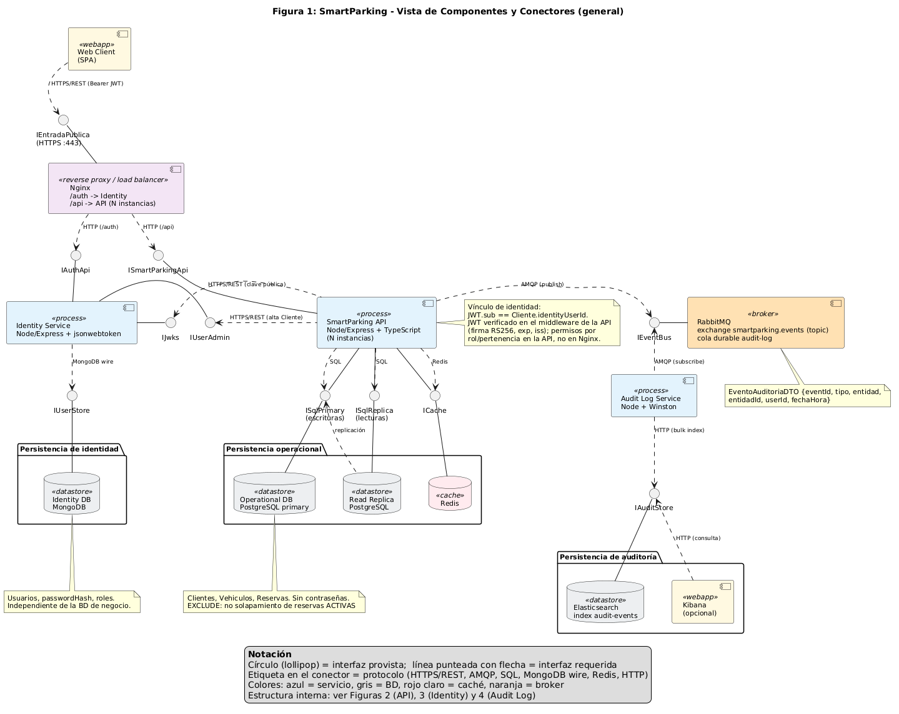
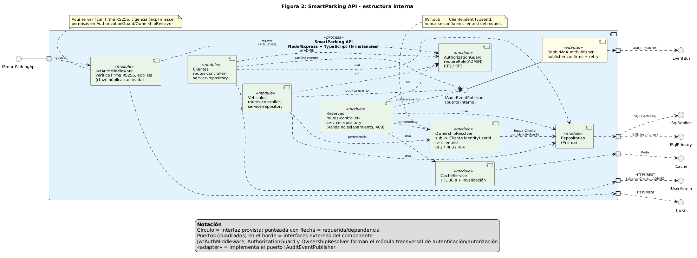
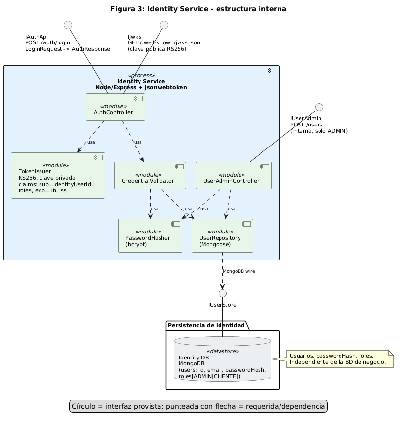
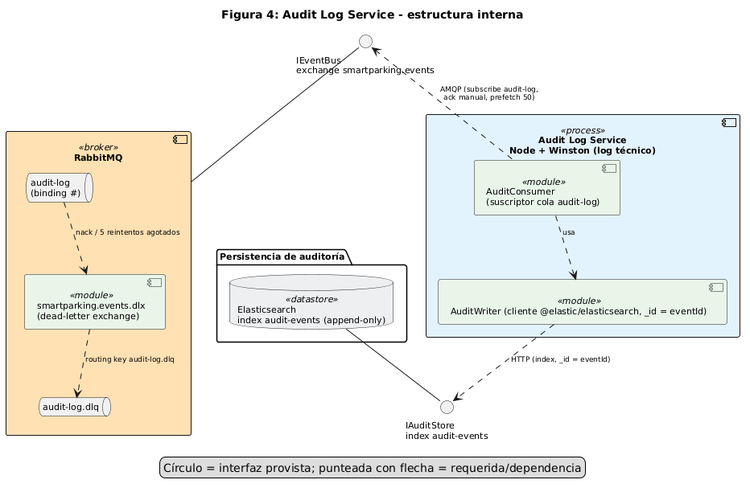

# SmartParking – Parte 1: Diseño arquitectónico

**Arquitectura de Software** · Evaluación grupal

**Integrantes:**

- Nombre y apellido – Nº de estudiante: ____________________
- Nombre y apellido – Nº de estudiante: ____________________
- Nombre y apellido – Nº de estudiante: ____________________
- Nombre y apellido – Nº de estudiante: ____________________
- Nombre y apellido – Nº de estudiante: ____________________

**Fecha:** 2026-10-28

---

## 1. Introducción y supuestos

SmartParking gestiona Clientes, Vehículos y Reservas de estacionamiento. Este documento presenta el diseño arquitectónico (sin código): vista de componentes y conectores (A1), dos escenarios de calidad con sus tácticas (A2), la decisión ADR-01 sobre cómo se comunican las operaciones exitosas al componente de registro de eventos (A3) y una revisión de coherencia (A4).

Reglas de dominio: un vehículo pertenece a un único cliente; una reserva usa un vehículo del cliente que reserva; no puede haber reservas ACTIVAS solapadas para el mismo vehículo.

**Supuestos explícitos**

| # | Supuesto |
|---|---|
| S1 | Existen solo dos roles: `ADMIN` y `CLIENTE`. El primer `ADMIN` se crea por *seed* en Identity. |
| S2 | Cancelar una reserva es un cambio de estado a `CANCELADA`; no se borra. |
| S3 | Borrar un cliente o un vehículo con reservas ACTIVAS se rechaza con 409. |
| S4 | El `accessToken` dura 1 h (`expiresIn` = 3600 s) y no hay *refresh token* (mejora futura). |
| S5 | El alta de un Cliente la hace un ADMIN; en ese acto se crea su usuario en Identity y se vincula por `Cliente.identityUserId`. |
| S6 | La comunicación interna API → Identity (`IUserAdmin`) está protegida con token de servicio / rol ADMIN. |
| S7 | Nginx es el único punto de entrada público; no valida JWT (eso se hace en la API). |
| S8 | Una operación "exitosa" es aquella cuya transacción en la BD operacional se confirmó (*commit*). |

---

## 2. A1 – Vista de Componentes y Conectores

### 2.1 Representación primaria y refinamientos



*Figura 1. Vista general: componentes, interfaces provistas/requeridas, conectores con su protocolo y las tres persistencias separadas.*



*Figura 2. SmartParking API: módulos por funcionalidad (Clientes, Vehículos, Reservas), módulo transversal de autenticación/autorización, puerto `IAuditEventPublisher` y su adapter.*



*Figura 3. Identity Service: controladores, validación de credenciales, emisión de tokens y repositorio de usuarios.*



*Figura 4. Audit Log Service: consumidor de la cola `audit-log` (con DLQ `audit-log.dlq`) y escritor hacia Elasticsearch mediante el cliente oficial `@elastic/elasticsearch` (`_id` = `eventId`).*

### 2.2 Catálogo de elementos

| Componente | Responsabilidad | Interfaces provistas | Interfaces requeridas | Tecnología (justificación breve) |
|---|---|---|---|---|
| **Web Client** `<<webapp>>` | Interfaz de usuario (Cliente y Admin); envía credenciales y luego el JWT como *Bearer*. | — | `IEntradaPublica` (→ `IAuthApi`, `ISmartParkingApi`) | SPA web; consume solo contratos HTTPS/REST. |
| **Nginx** `<<reverse proxy / load balancer>>` | Punto de entrada único; enruta `/auth` → Identity y `/api` → N instancias API; balancea carga. No valida JWT. | `IEntradaPublica` (HTTPS :443) | `IAuthApi`, `ISmartParkingApi` | Nginx: proxy inverso y balanceador liviano; restringe caminos de comunicación. |
| **Identity Service** `<<process>>` | Autenticar contra su propio repositorio de usuarios, emitir JWT, publicar la clave pública, crear usuarios (rol CLIENTE) por pedido interno de ADMIN. | `IAuthApi`, `IJwks`, `IUserAdmin` | `IUserStore` | Node.js + Express + `jsonwebtoken`: mismo stack que la API; RS256. |
| ↳ AuthController | Atiende login (LoginRequest → AuthResponse) y publica JWKS. | `IAuthApi`, `IJwks` | CredentialValidator, TokenIssuer | Express. |
| ↳ UserAdminController | Alta de usuario (solo ADMIN); devuelve `identityUserId`. | `IUserAdmin` | PasswordHasher, UserRepository | Express. |
| ↳ CredentialValidator | Verifica email + contraseña contra el hash almacenado. | — | PasswordHasher, UserRepository | — |
| ↳ PasswordHasher | Hash y comparación de contraseñas. | — | — | `bcrypt`: hash adaptativo con sal. |
| ↳ TokenIssuer | Firma el JWT con clave privada RS256; claims `sub`=identityUserId, `roles`, `exp`=1 h, `iss`. | — | — | `jsonwebtoken` (RS256). |
| ↳ UserRepository | Acceso a usuarios, `passwordHash` y roles. | — | `IUserStore` | Mongoose. |
| **Identity DB** `<<datastore>>` | Persistir usuarios, `passwordHash` y roles, independiente de la BD de negocio. | `IUserStore` | — | MongoDB: motor y servidor distintos al operacional; documentos de usuario. |
| **SmartParking API** `<<process>>` (N instancias) | CRUD de clientes, vehículos y reservas; reglas de negocio; verifica JWT y permisos; publica eventos de auditoría. | `ISmartParkingApi` | `IJwks`, `IUserAdmin`, `ISqlPrimary`, `ISqlReplica`, `ICache`, `IEventBus` | Node.js + TypeScript + Express; *package by feature* + capas routes→controller→service→repository. |
| ↳ JwtAuthMiddleware | Verifica firma RS256, `exp` e `iss`, localmente, con clave pública cacheada; deja `req.user` (sub, roles). | — | `IJwks` | `jsonwebtoken` (verify). |
| ↳ AuthorizationGuard | `requireRole('ADMIN')` para RF1 y RF5. | — | — | Middleware Express. |
| ↳ OwnershipResolver | Resuelve `sub` → `Cliente.identityUserId` → `clienteId` y controla la pertenencia (RF2, RF3, RF4). | — | Repositories | Middleware/servicio Express. |
| ↳ Clientes / Vehículos / Reservas | Módulos por funcionalidad; Reservas valida no solapamiento (409). Clientes invoca `IUserAdmin` en el alta. | — | Guard, Owner, Repositories, CacheService (Reservas), `IAuditEventPublisher` | TypeScript. |
| ↳ Repositories | Acceso a PostgreSQL: escrituras a primaria, lecturas a réplica. | — | `ISqlPrimary`, `ISqlReplica` | Prisma (migración SQL manual para `EXCLUDE`). |
| ↳ CacheService | Caché de consultas de reservas, TTL 30 s e invalidación en alta/modificación/cancelación. | — | `ICache` | Cliente Redis. |
| ↳ `IAuditEventPublisher` (puerto) | Contrato interno `publicar(EventoAuditoriaDTO)`; único acoplamiento de los módulos CRUD con la auditoría. | puerto | — | Interfaz TypeScript. |
| ↳ RabbitMqAuditPublisher `<<adapter>>` | Implementa el puerto; publica en el exchange con *publisher confirms* y reintentos con *backoff*. | `IAuditEventPublisher` | `IEventBus` | `amqplib`. |
| **Operational DB** `<<datastore>>` | Persistencia primaria de Clientes, Vehículos y Reservas (sin contraseñas); `EXCLUDE` de no solapamiento. | `ISqlPrimary` | — | PostgreSQL: relacional, soporta restricción `EXCLUDE USING gist`. |
| **Read Replica** `<<datastore>>` | Copia de lectura de la BD operacional (replicación desde la primaria). | `ISqlReplica` | `ISqlPrimary` (replicación) | PostgreSQL (réplica en *streaming*). |
| **Redis** `<<cache>>` | Caché de consultas de reservas (propias y globales con filtros). | `ICache` | — | Redis: memoria, TTL nativo. |
| **RabbitMQ** `<<broker>>` | Intermediario *pub/sub*: exchange `smartparking.events` (topic); cola durable `audit-log`. | `IEventBus` | — | RabbitMQ (AMQP): colas durables, confirms. |
| **Audit Log Service** `<<process>>` | Suscribirse a la cola `audit-log` y persistir cada evento en su log independiente. | — | `IEventBus`, `IAuditStore` | Node.js + Winston (log técnico). |
| ↳ AuditConsumer | Consume mensajes de la cola `audit-log` y confirma (ack) tras persistir. | — | `IEventBus`, AuditWriter | `amqplib`. |
| ↳ AuditWriter | Escribe el evento en Elasticsearch con `_id` = `eventId` (idempotente ante reentregas). | — | `IAuditStore` | Cliente oficial `@elastic/elasticsearch`. |
| **Elasticsearch** `<<datastore>>` | Almacén append-only del índice `audit-events`. | `IAuditStore` | — | Elasticsearch: indexación y búsqueda de eventos. |
| **Kibana** `<<webapp>>` (opcional) | Consulta del audit trail. | — | `IAuditStore` | Kibana. |

### 2.3 Interfaces y contratos

| Interfaz | Proveedor | Consumidores | Protocolo | Operaciones / DTOs |
|---|---|---|---|---|
| `IEntradaPublica` | Nginx | Web Client | HTTPS :443 | Reenvía `/auth` y `/api`. |
| `IAuthApi` | Identity Service | Web Client (vía Nginx) | HTTPS/REST | Login: `LoginRequest {email, password}` → `AuthResponse {accessToken: JWT, expiresIn: number}`. |
| `ISmartParkingApi` | SmartParking API | Web Client (vía Nginx) | HTTPS/REST, `Authorization: Bearer` | `/clientes` (ClienteDTO, RF1), `/vehiculos` (VehiculoDTO, RF2), `/reservas` (ReservaDTO, RF3), `/reservas/mias` (RF4), `/admin/reservas?cliente&estado&desde&hasta` (RF5, ReservaFiltroDTO). |
| `IJwks` | Identity Service | SmartParking API | HTTPS/REST | Publica la clave pública RS256 (JWKS) para verificar firmas. |
| `IUserAdmin` | Identity Service | SmartParking API (módulo Clientes) | HTTPS/REST interno, solo ADMIN | `CrearUsuarioRequest {email, password, rol}` → `CrearUsuarioResponse {identityUserId}`. |
| `IUserStore` | Identity DB | Identity Service | MongoDB wire | Usuarios, `passwordHash`, roles. |
| `ISqlPrimary` | Operational DB | SmartParking API, Read Replica | SQL | Escrituras; replicación hacia la réplica. |
| `ISqlReplica` | Read Replica | SmartParking API | SQL | Lecturas. |
| `ICache` | Redis | SmartParking API | Redis | get/set con TTL, invalidación. |
| `IEventBus` | RabbitMQ | API (publica), Audit Log (suscribe) | AMQP | Mensaje `EventoAuditoriaDTO` en exchange `smartparking.events`. |
| `IAuditEventPublisher` | Adapter RabbitMQ (puerto interno) | Módulos Clientes, Vehículos, Reservas | Llamada en proceso | `publicar(EventoAuditoriaDTO)`. |
| `IAuditStore` | Elasticsearch | Audit Log Service, Kibana | HTTP | Indexación en bloque / consulta. |

**DTOs del enunciado:** ClienteDTO, VehiculoDTO, ReservaDTO, LoginRequest, AuthResponse y EventoAuditoriaDTO `{eventId, tipo, entidad, entidadId, userId, fechaHora}`.

**DTOs agregados por el diseño:**

- `CrearUsuarioRequest {email, password, rol}` / `CrearUsuarioResponse {identityUserId}`: necesarios para que la API cree el usuario del Cliente en Identity sin que la contraseña pase por la BD de negocio; el `identityUserId` devuelto se guarda en `Cliente.identityUserId`.
- `ReservaFiltroDTO {clienteId?, estado?, desde?, hasta?}`: parámetros de consulta de RF5 (solo ADMIN); todos opcionales y combinables.

Ejemplo de evento:

```json
{ "eventId": "uuid", "tipo": "CREAR", "entidad": "Reserva", "entidadId": "123", "userId": "<sub del JWT>", "fechaHora": "2026-10-28T10:15:00Z" }
```

### 2.4 Flujos

**Autenticación y autorización**

1. El usuario envía `LoginRequest {email, password}` a `/auth` (Nginx → `IAuthApi`).
2. Identity (AuthController) valida con CredentialValidator: busca el usuario en Identity DB y compara con bcrypt.
3. TokenIssuer firma el JWT con la clave privada RS256 (`sub`=identityUserId, `roles`, `exp`, `iss`) y responde `AuthResponse {accessToken, expiresIn}`.
4. El cliente envía cada pedido a `/api` con `Authorization: Bearer <accessToken>`.
5. Nginx balancea hacia una instancia de la API (no valida el token).
6. JwtAuthMiddleware verifica firma, vigencia e issuer; si falla, responde 401.
7. AuthorizationGuard exige rol ADMIN en RF1 y RF5 (403 si no).
8. OwnershipResolver, para RF2/RF3/RF4, resuelve `sub` → `Cliente.identityUserId` → `clienteId` y restringe los datos a ese cliente; nunca se usa un `clienteId` enviado por el navegador.

**¿Dónde se verifican firma, vigencia y permisos?**

| Verificación | Dónde | Cómo |
|---|---|---|
| Firma (integridad y origen) | JwtAuthMiddleware, en la SmartParking API | RS256 con la clave pública de `IJwks`, cacheada; no se llama a Identity en cada pedido. La API no puede fabricar tokens (no tiene la privada). |
| Vigencia | JwtAuthMiddleware | Control de `exp` (1 h) e `iss`. |
| Permisos por rol | AuthorizationGuard (API) | `requireRole('ADMIN')` sobre los claims `roles`. |
| Permisos por pertenencia | OwnershipResolver (API) | `sub` == `Cliente.identityUserId`; el recurso debe pertenecer a ese cliente. |
| Credenciales | CredentialValidator + PasswordHasher (Identity) | Solo en el login. |

Nginx no verifica nada del token.

**Alta de Cliente**

1. ADMIN envía ClienteDTO al módulo Clientes (RF1); el guard verifica rol ADMIN.
2. La API llama a `IUserAdmin` con `CrearUsuarioRequest {email, password, rol=CLIENTE}`.
3. Identity hashea la contraseña (bcrypt), crea el usuario en Identity DB y devuelve `{identityUserId}`.
4. La API persiste el Cliente (sin contraseña) con `identityUserId` en la Operational DB.
5. Se publica el evento de auditoría (flujo siguiente).

**Evento de auditoría**

1. El service ejecuta la operación y la transacción hace *commit* en la Operational DB.
2. Recién entonces el módulo invoca `IAuditEventPublisher.publicar(EventoAuditoriaDTO)`.
3. RabbitMqAuditPublisher publica en el exchange `smartparking.events` (topic) y espera el *publisher confirm*; ante falla reintenta con *backoff*; si agota los reintentos, registra el error en el log técnico (Winston).
4. El exchange enruta a la cola durable `audit-log`.
5. AuditConsumer consume el mensaje, AuditWriter lo indexa en Elasticsearch (`audit-events`) y confirma (ack).
6. El pedido original ya respondió al cliente sin esperar los pasos 3 a 5.

### 2.5 Persistencias separadas

| Almacén | Contenido | Por qué separado |
|---|---|---|
| Identity DB (MongoDB) | Usuarios, `passwordHash`, roles | Exigido por el enunciado: usuarios y credenciales independientes de la BD relacional de negocio. Reduce la superficie de exposición de credenciales. **Cliente no almacena contraseñas**; solo `identityUserId`. |
| Operational DB (PostgreSQL) + Read Replica + Redis | Clientes, Vehículos, Reservas | Datos de negocio con integridad relacional. La restricción `EXCLUDE USING gist (vehiculo_id WITH =, tstzrange(inicio, fin) WITH &&) WHERE estado='ACTIVA'` garantiza el no solapamiento incluso ante concurrencia; ReservaService además lo valida y responde 409. |
| Audit store (Elasticsearch) | Eventos de auditoría | Log independiente, append-only, escalable y consultable sin tocar la BD de negocio. |

### 2.6 Trazabilidad requisito → componentes

| Requisito | Componentes |
|---|---|
| RF1 CRUD clientes (ADMIN) | Clientes, AuthorizationGuard, `IUserAdmin`, Repositories, Operational DB |
| RF2 CRUD vehículos (propios / ADMIN) | Vehículos, OwnershipResolver, AuthorizationGuard, Repositories |
| RF3 crear/modificar/cancelar/consultar reservas (propias / ADMIN) | Reservas, OwnershipResolver, Guard, Repositories, CacheService |
| RF4 consulta de reservas propias | `/reservas/mias`, JwtAuthMiddleware (`sub`), OwnershipResolver, CacheService, Read Replica |
| RF5 consulta global con filtros | `/admin/reservas` con ReservaFiltroDTO, AuthorizationGuard (ADMIN), CacheService, Read Replica |
| No solapamiento de reservas ACTIVAS | ReservaService (409) + `EXCLUDE` en Operational DB |
| Registro de eventos en cada alta/modificación/cancelación exitosa | `IAuditEventPublisher`, RabbitMqAuditPublisher, RabbitMQ, Audit Log Service, Elasticsearch |
| Auth propia, usuarios aparte, JWT vinculado a Cliente | Identity Service, Identity DB, `Cliente.identityUserId` |

### 2.7 Tácticas de seguridad aplicadas

| Atributo | Categoría | Táctica | Ubicación | Tecnología |
|---|---|---|---|---|
| Seguridad | Resistir ataques | Autenticar actores | CredentialValidator + TokenIssuer (Identity); JwtAuthMiddleware (API) | bcrypt, `jsonwebtoken` |
| Seguridad | Resistir ataques | Autorizar actores | AuthorizationGuard (rol ADMIN) y OwnershipResolver (pertenencia) en la API | Middleware Express |
| Seguridad | Resistir ataques | Limitar acceso | Nginx como único punto de entrada; `IUserAdmin` solo ADMIN; Identity DB no accesible desde la API | Nginx, red interna |
| Seguridad | Detectar ataques | Verificar integridad de los mensajes | JwtAuthMiddleware: firma RS256 del JWT | `jsonwebtoken` (el JWT es la herramienta; la táctica es la verificación) |
| Seguridad | Recuperarse de ataques | Mantener audit trail | Audit Log Service + Elasticsearch | RabbitMQ, Winston, Elasticsearch |

---

## 3. A2 – Escenarios de calidad

### 3.1 Escenario 1 – Performance

| Parte | Descripción |
|---|---|
| **Fuente** | Usuarios (clientes y administradores) |
| **Estímulo** | 500 solicitudes de consulta por segundo (RF4 y RF5) |
| **Artefacto** | SmartParking API + persistencia operacional (Operational DB, Read Replica, Redis) |
| **Entorno** | Operación normal |
| **Respuesta** | El sistema procesa todas las consultas sin errores |
| **Medida de respuesta** | Latencia p95 < 300 ms y 0 % de solicitudes rechazadas a 500 req/s |

**Tácticas**

| Atributo | Categoría | Táctica | Ubicación | Tecnología |
|---|---|---|---|---|
| Performance | Gestionar recursos | Múltiples copias de cómputos | N instancias de la SmartParking API detrás del balanceador (Nginx) | Nginx, Node.js |
| Performance | Gestionar recursos | Múltiples copias de datos | Read Replica (`ISqlReplica`, lecturas) y caché de consultas (`ICache`, TTL 30 s con invalidación en alta/modificación/cancelación) | PostgreSQL réplica, Redis |
| Performance | Controlar demanda de recursos | Reducir overhead | JwtAuthMiddleware valida el JWT localmente con la clave pública cacheada, sin llamar a Identity | `jsonwebtoken` RS256, caché de JWKS |
| Performance | Controlar demanda de recursos | Limitar la respuesta a eventos | La auditoría es asíncrona (conector API → RabbitMQ): las escrituras no retienen hilos ni conexiones esperando al log, así que las instancias de la API conservan capacidad para las consultas | RabbitMQ, `amqplib` |

**Trade-offs.** La caché (TTL 30 s) y la réplica introducen consistencia eventual: una consulta puede mostrar datos con hasta ~30 s de antigüedad, mitigado con invalidación explícita en las escrituras. Más instancias y más componentes (réplica, Redis) implican mayor costo de infraestructura y operación.

**Verificación.** Prueba de carga (p. ej. k6 o JMeter) con 500 req/s sostenidos de consultas RF4/RF5 sobre datos representativos; se mide p95 y tasa de errores/rechazos contra la medida del escenario.

### 3.2 Escenario 2 – Modificabilidad / Integrabilidad

| Parte | Descripción |
|---|---|
| **Fuente** | Equipo de desarrollo |
| **Estímulo** | Reemplazar el mecanismo de registro de eventos (p. ej. RabbitMQ → HTTP/REST o Kafka) |
| **Artefacto** | Adapter de auditoría de la SmartParking API |
| **Entorno** | Tiempo de diseño/desarrollo |
| **Respuesta** | El cambio se realiza implementando un nuevo adapter de `IAuditEventPublisher` y cambiando configuración |
| **Medida de respuesta** | 0 archivos modificados en los módulos Clientes/Vehículos/Reservas; cambio limitado a 1 adapter + configuración; < 1 día-persona |

**Tácticas**

| Atributo | Categoría | Táctica | Ubicación | Tecnología |
|---|---|---|---|---|
| Modificabilidad | Reducir acoplamiento | Encapsular | Puerto `IAuditEventPublisher` (interfaz estable que oculta el mecanismo de transporte) | Interfaz TypeScript |
| Modificabilidad | Reducir acoplamiento | Uso de intermediario | RabbitMqAuditPublisher (adapter) y RabbitMQ entre la API y el Audit Log | `amqplib`, RabbitMQ |
| Modificabilidad | Reducir acoplamiento | Restringir dependencias | Los módulos CRUD dependen solo del puerto, nunca del adapter ni de `amqplib` | Estructura de paquetes / reglas de importación |
| Modificabilidad | Diferir enlaces | Configuración (tiempo de inicio) | El adapter se selecciona por configuración al iniciar la API | Variables de entorno / configuración |
| Modificabilidad | Diferir enlaces | Publicador-suscriptor (tiempo de ejecución) | Exchange `smartparking.events`: se pueden sumar suscriptores sin tocar la API | RabbitMQ (topic exchange) |
| Integrabilidad | Limitar dependencias | Adherir a estándares | Contratos explícitos: EventoAuditoriaDTO (JSON), AMQP, REST (`IAuthApi`, `IUserAdmin`), JWT/JWKS (`IJwks`) | JSON, AMQP, REST, JWT/JWKS |
| Integrabilidad | Limitar dependencias | Restringir caminos de comunicación | La API solo interactúa con Identity por `IAuthApi`/`IJwks`/`IUserAdmin` y con el log por `IEventBus` | Contratos de interfaz |

**Trade-off.** La indirección extra (puerto + adapter + broker) agrega una capa a mantener y a depurar, a cambio de aislar el cambio.

---

## 4. A3 – ADR-01

<!-- include: adr/ADR-01-comunicacion-log.md -->
El ADR-01 se mantiene en [adr/ADR-01-comunicacion-log.md](adr/ADR-01-comunicacion-log.md); al generar el PDF se inserta aquí.

---

## 5. A4 – Revisión de coherencia

| Requisito / decisión | Dónde está en el diagrama | Escenario / táctica | ADR |
|---|---|---|---|
| Registro de eventos asíncrono | Figura 1: API → `IEventBus` (AMQP publish) → RabbitMQ → Audit Log; Figura 4 | Esc. 1: limitar la respuesta a eventos; Seguridad: mantener audit trail | ADR-01 opción B |
| Cambiar mecanismo de registro sin tocar CRUD | Figura 2: `IAuditEventPublisher` + `RabbitMqAuditPublisher` `<<adapter>>` | Esc. 2: encapsular, intermediario, restringir dependencias, diferir enlaces | ADR-01 (consecuencias positivas) |
| Pub/sub con suscriptores adicionales | Figura 1: exchange topic `smartparking.events`, cola `audit-log` | Esc. 2: publicador-suscriptor | ADR-01 decisión |
| Falla de RabbitMQ | Figura 2: adapter con confirms + retry | — | ADR-01 consecuencias negativas (mitigación, Outbox futuro) |
| Auth propia con usuarios separados | Figuras 1 y 3: Identity Service, Identity DB (MongoDB) | Seguridad: autenticar actores | — |
| Vínculo JWT ↔ Cliente | Notas de Figuras 1 y 2: `JWT.sub == Cliente.identityUserId` | Seguridad: autorizar actores | — |
| Dónde se verifican firma/vigencia/permisos | Figura 2: JwtAuthMiddleware, AuthorizationGuard, OwnershipResolver | Seguridad: verificar integridad de mensajes; Performance: reducir overhead | — |
| Sin contraseñas en Cliente | Figura 1: nota de Operational DB; Identity DB guarda `passwordHash` | Seguridad: limitar acceso | — |
| 500 req/s, p95 < 300 ms | Figura 1: Nginx, N instancias API, Read Replica, Redis | Esc. 1: múltiples copias de cómputos y de datos | ADR-01 (CRUD no espera al log) |
| No solapamiento | Figura 2: Reservas (409); Figura 1: nota `EXCLUDE` | — | — |
| Integrabilidad por contratos explícitos | Figura 1: `IAuthApi`, `IJwks`, `IUserAdmin`, `IEventBus` | Esc. 2: adherir a estándares, restringir caminos | ADR-01 (EventoAuditoriaDTO) |

Verificaciones cruzadas: (i) los nombres de componentes e interfaces del texto son idénticos a los de las Figuras 1–4; (ii) lo decidido en ADR-01 (asíncrono, RabbitMQ) coincide con el conector de la Figura 1 y con ambos escenarios; (iii) ninguna táctica se atribuye a una herramienta (JWT, RabbitMQ, Redis son tecnologías que implementan tácticas, no tácticas); (iv) la caché/réplica, con consistencia eventual, se declara como trade-off en el escenario 1 y no contradice la regla de no solapamiento, que se garantiza en la primaria (escrituras a `ISqlPrimary`).

---

## 6. Tecnologías seleccionadas

| Tecnología | Uso | Justificación |
|---|---|---|
| Node.js + TypeScript + Express | SmartParking API, Identity, Audit Log | Stack visto en el curso; un solo lenguaje; I/O no bloqueante adecuado para consultas concurrentes; tipado para los contratos. |
| `jsonwebtoken` (RS256) | Emisión (Identity) y verificación (API) del JWT | Firma asimétrica: solo Identity firma; la API verifica con la pública, sin llamar a Identity (Performance + Seguridad). |
| bcrypt | Hash de contraseñas | Hash adaptativo con sal; las contraseñas nunca se guardan en claro ni en Cliente. |
| MongoDB + Mongoose | Identity DB | Servidor y modelo distintos al operacional: separación evidente; documentos de usuario simples. |
| PostgreSQL + Prisma (+ `EXCLUDE`) | Operational DB y Read Replica | Integridad relacional y restricción `EXCLUDE` para no solapamiento; réplica para lecturas; ORM visto en el curso. |
| Redis | Caché de consultas de reservas (TTL 30 s) | Latencia mínima y TTL nativo; táctica de múltiples copias de datos. |
| Nginx | Reverse proxy y balanceador | Punto de entrada único y balanceo entre N instancias (múltiples copias de cómputos). |
| RabbitMQ (`amqplib`) | Bus de eventos pub/sub | Intermediario asíncrono con colas durables y confirms; sostiene ADR-01 y el escenario 2. |
| Elasticsearch (cliente oficial) + Winston (+ Kibana) | Audit trail independiente (Elasticsearch) y log técnico (Winston) | Almacén append-only con búsqueda; escritura confirmada antes del `ack` e idempotente (`_id` = `eventId`); Kibana para consulta. |

---

## 7. Declaración de uso de IA

Se utilizó Claude (Anthropic) como asistente para organizar el análisis, proponer alternativas y redactar borradores; todas las decisiones fueron tomadas, revisadas y validadas por el equipo, que es responsable del contenido.
